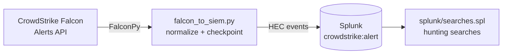

# Falcon → SIEM Bridge

A small, single-file connector that pulls **CrowdStrike Falcon** alerts, normalizes them into a flat, SIEM-friendly schema and forwards them to **Splunk** over the HTTP Event Collector (HEC). It ships with starter hunting searches for the data.



## What it does

1. **Pull:** queries new alerts since the last checkpoint with FalconPy (`query_alerts_v2`, then `get_alerts_v2` in batches of 100).
2. **Normalize:** flattens each alert into fields such as `rule_name`, `severity`, `mitre_tactic`, `mitre_technique_id`, `host`, `user`, `cmdline` and `sha256`, so searches don't depend on Falcon's nested structure.
3. **Forward:** wraps each event in a Splunk HEC envelope (using the alert's own timestamp) and posts a batch.
4. **Checkpoint:** advances `.checkpoint.json` only after a successful send, so a failed run is retried and not skipped.

## Try it now (no credentials)

```bash
python falcon_to_siem.py --sample --dry-run
```

Output for the bundled fake alerts:

```
1791882902.114 crowdstrike:alert WKS-DEMO-01  | High     T1059.001 Suspicious PowerShell download cradle
1791883361.87  crowdstrike:alert SRV-DEMO-DC1 | Critical T1003.001 Credential dumping attempt
1791883869.002 crowdstrike:alert WKS-DEMO-02  | Medium   T1036     Unsigned binary run from temp folder
```

(Each line above is a summary of the full JSON event the script prints.)

## Run it for real

```bash
pip install -r requirements.txt
export FALCON_CLIENT_ID=... FALCON_CLIENT_SECRET=...     # API client with the "Alerts: Read" scope
export FALCON_CLOUD=us1                                  # us1, us2, eu1, usgov1 ...
export SPLUNK_HEC_URL=https://splunk.lab:8088/services/collector/event
export SPLUNK_HEC_TOKEN=...

python falcon_to_siem.py --dry-run     # read-only: fetch from Falcon and print, send nothing
python falcon_to_siem.py               # fetch and forward to Splunk
```

Run it on a schedule (cron, a systemd timer or a Kubernetes CronJob) every few minutes. The first run looks back 60 minutes, and later runs start from the checkpoint.

## Splunk content

- `splunk/props.conf` extracts the JSON fields at search time for the `crowdstrike:alert` sourcetype.
- `splunk/searches.spl` has four starter searches: alerts by tactic and severity, noisiest hosts, open high/critical alerts and the same hash on multiple hosts.

## Design notes

- The Falcon API client only needs read access to alerts, so use a read-only scope.
- Credentials come from environment variables and are never written to disk. `.env` and the checkpoint are git-ignored.
- `--dry-run` never sends anything, and `--sample` never calls Falcon, so both are safe for demos.
- The bundled sample alerts are entirely fictional (demo hostnames, private IPs and dummy hashes).
- Swapping Splunk for another SIEM only means changing `to_hec` and `send_to_splunk`.

## Verification status

- Tested: the offline `--sample` path end to end (output above).
- Tested read-only against a live Falcon tenant: the Alerts API queries and the normalization step ran without errors.
- Not tested: the actual HEC send to Splunk, and the Splunk searches against real indexed data.
